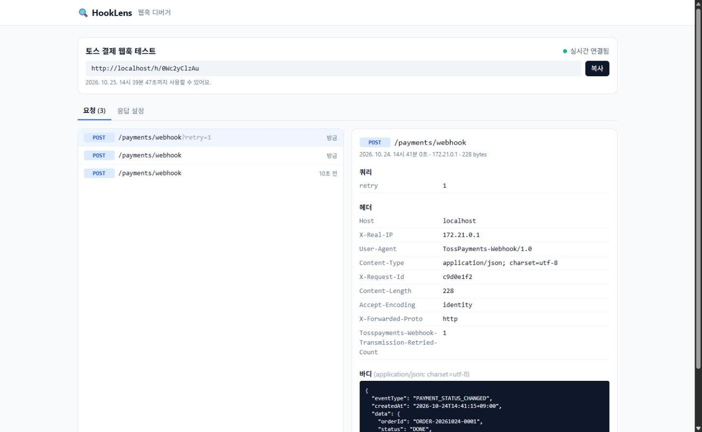
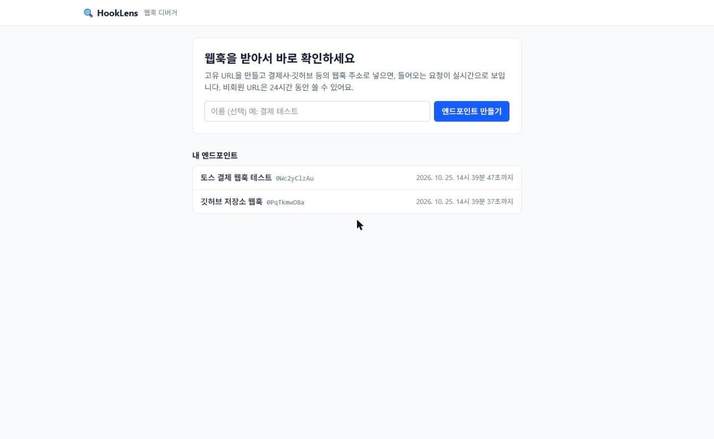
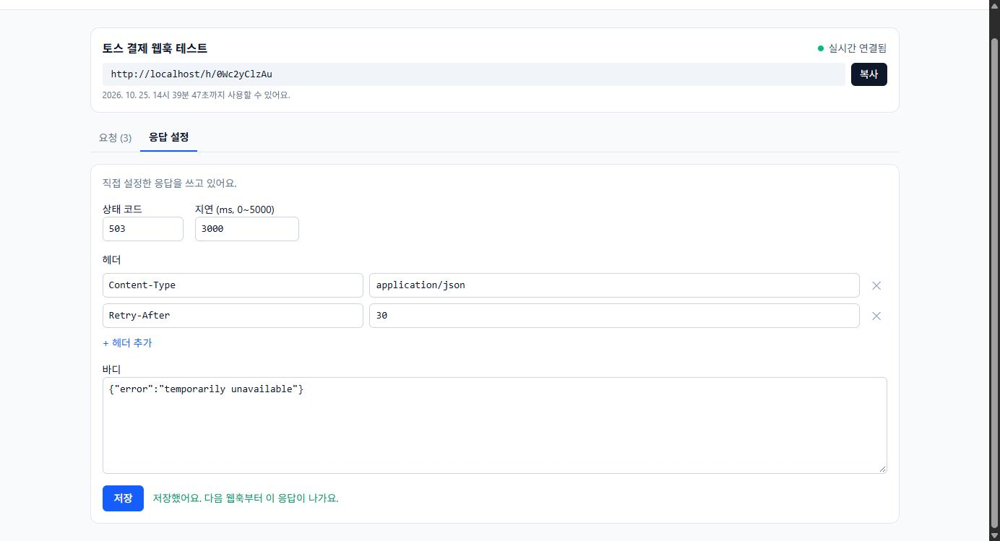

# HookLens

결제사나 깃허브가 보내는 웹훅을 고유 URL로 받아서 실시간으로 보여주고, 정해 둔 응답을 돌려주는 웹훅 디버거입니다.
개인 프로젝트로 2026.10.13 ~ 10.22에 만들었습니다. (Spring Boot 4 · React 19 · MySQL · Docker)

📄 [기획서](docs/planning.md) · [API 명세서](docs/api.md) · [프로젝트 기술서 (PDF)](docs/portfolio/HookLens_프로젝트기술서.pdf) · [포트폴리오 (PDF)](docs/portfolio/HookLens_포트폴리오.pdf)



## 만든 이유

결제 연동을 하다 보면 세 가지에서 막힙니다.

- 결제사가 실제로 어떤 헤더와 바디를 보내는지 문서만으로는 확인하기 어렵다.
- 결제사 서버는 인터넷에 있어서 개발 중인 내 PC(localhost)로는 웹훅을 보내 주지 않는다.
- 우리 서버가 실패하거나 느릴 때 결제사가 재전송하는지 미리 확인하고 싶다.

HookLens는 인터넷에서 접근할 수 있는 주소를 하나 만들어 주고, 거기로 들어온 요청을 가공하지 않고 그대로 기록해서 화면에 바로 띄웁니다. 응답 코드와 지연 시간을 바꿔서 실패 상황도 만들어 볼 수 있습니다. webhook.site, RequestBin과 같은 종류의 도구입니다.

## 기능

| 기능 | 설명 |
| --- | --- |
| 엔드포인트 발급 | 가입 없이 버튼 한 번으로 `/h/{slug}` 주소 발급. 비회원 주소는 24시간 후 만료(이후 410) |
| 웹훅 수신·기록 | 모든 메서드와 하위 경로를 받고 메서드·경로·쿼리·헤더·바디·IP·시각을 원본 그대로 저장 |
| 실시간 반영 | 새 요청이 들어오면 새로고침 없이 목록에 바로 표시 (SSE) |
| 목록·상세 | 최신순 커서 페이지네이션, 상세에서 쿼리·헤더·바디(JSON 정렬) 확인 |
| 응답 설정 | 상태 코드·헤더·바디·지연(0~5초)을 정하면 다음 웹훅부터 그대로 응답 |

| 홈 | 응답 설정 |
| --- | --- |
|  |  |

## 구조

```
[결제사·깃허브] ──POST /h/{slug}──┐
                                  ▼
[브라우저] ──/, /api──▶ Nginx ──▶ Spring Boot ──▶ MySQL
     ▲                  (정적 파일,   │
     └──── SSE ─────────  프록시)     └─ 저장 → 커밋 후 이벤트 → 연결된 화면에 전송
```

- 웹훅 수신 → 로그 저장 → 커밋이 끝나면 `RequestReceivedEvent` → SSE로 그 엔드포인트를 보고 있는 화면에 전송
- 관리 API는 발급 때 한 번만 받는 익명 토큰(`X-Anonymous-Token`)으로 주인을 확인합니다. DB에는 SHA-256 해시만 저장합니다.
- 배포 구성은 Nginx + 백엔드 + MySQL을 Docker Compose 하나로 띄우는 형태입니다. 밖으로는 80번만 엽니다.

## 기술 스택

- Backend: Java 21, Spring Boot 4.0, Spring Data JPA, MySQL 8, 가상 스레드
- Frontend: React 19, Vite 8, React Router 7, Axios, Tailwind CSS 4
- Test: JUnit 5, Testcontainers(MySQL), MockMvc
- Infra: Docker, Docker Compose, Nginx (EC2 한 대 기준)

## 고민했던 부분

자세한 과정은 [프로젝트 기술서](docs/portfolio/HookLens_프로젝트기술서.pdf)에 정리했습니다.

**SSE 인증을 헤더로 유지하기**
브라우저 `EventSource`는 커스텀 헤더를 못 보냅니다. 토큰을 쿼리 파라미터로 넘기면 Nginx 로그와 브라우저 기록에 남아서, `fetch`로 스트림을 직접 읽고 SSE 메시지를 파싱하는 훅을 만들었습니다. 끊기면 3초 뒤 다시 연결하고, 그사이 놓친 요청은 목록 API로 다시 받아옵니다.

**알림은 커밋이 끝난 뒤에 보내기**
저장 도중에 알림을 보내면 화면이 상세를 조회했을 때 아직 커밋 전이라 404가 날 수 있고, 롤백되면 없는 요청을 알리게 됩니다. `@TransactionalEventListener(AFTER_COMMIT)`로 커밋된 뒤에만 보내고, 수신 서비스는 이벤트만 발행해서 SSE 쪽을 모르게 했습니다.

**지연 응답이 DB 커넥션을 잡지 않게**
응답 지연(최대 5초)을 트랜잭션 안에서 기다리면 커넥션 풀(기본 10개)이 금방 바닥납니다. 로그는 먼저 커밋하고 컨트롤러에서 기다리게 했고, 기다리는 동안 톰캣 스레드가 묶이지 않도록 가상 스레드를 켰습니다.

**새 데이터가 계속 들어오는 목록의 페이지네이션**
오프셋 방식은 보는 도중 새 웹훅이 들어오면 목록이 밀려 같은 요청이 두 번 보이거나 빠집니다. `request_id < cursor` 커서 방식으로 바꾸고 `(endpoint_id, request_id DESC)` 인덱스를 탔습니다. 다음 페이지 여부는 COUNT 대신 `size + 1`개를 조회해서 판단합니다.

**남의 데이터 조회(IDOR)와 헤더 주입 막기**
요청 상세는 `id`와 `endpoint_id`를 같이 조건으로 걸어서 남의 요청은 조회 자체가 안 되게 했고, 존재 여부를 숨기려고 403이 아닌 404로 응답합니다. 사용자가 정한 응답 헤더는 웹훅 응답에 그대로 나가기 때문에, 헤더 이름은 허용 문자만 받고 값의 줄바꿈은 막았습니다.

## API

| 메서드 | 경로 | 설명 |
| --- | --- | --- |
| POST | `/api/endpoints` | 엔드포인트 발급 (토큰은 이 응답에서만 제공) |
| ANY | `/h/{slug}/**` | 웹훅 수신 |
| GET | `/api/endpoints/{slug}/requests?cursor=&size=` | 요청 목록 (최신순, 커서) |
| GET | `/api/endpoints/{slug}/requests/{requestId}` | 요청 상세 |
| GET | `/api/endpoints/{slug}/stream` | 새 요청 실시간 수신 (SSE) |
| GET / PUT | `/api/endpoints/{slug}/response` | 응답 설정 조회 / 저장 |

관리 API는 `{ "success", "data", "error": { "code", "message" } }` 형식으로 응답하고 `X-Anonymous-Token` 헤더가 필요합니다. 요청·응답 예시와 에러 코드는 [API 명세서](docs/api.md)에 있습니다.

## 실행

```bash
# 운영과 같은 구성으로 한 번에 실행 (Nginx + 백엔드 + MySQL)
cp .env.prod.example .env.prod   # 비밀번호와 HOOKLENS_BASE_URL=http://localhost 로 수정
docker compose -f docker-compose.prod.yml --env-file .env.prod up -d --build
# http://localhost
```

개발용으로 따로 띄울 때는 `docker compose up -d`(MySQL) 후 `backend`에서 `./gradlew bootRun`, `frontend`에서 `npm run dev`를 실행합니다. EC2 배포 절차는 [docs/deploy.md](docs/deploy.md)에 있습니다.

## 테스트

```bash
cd backend && ./gradlew test   # Docker 필요 (Testcontainers로 MySQL을 띄움)
```

테스트 59개. H2 대신 실제 MySQL 컨테이너로 통합 테스트를 돌리고, SSE는 실제 포트로 서버를 띄워 스트림에 연결한 상태에서 웹훅을 보내 이벤트가 도착하는지 확인합니다.

## 아직 안 한 것

- EC2 실제 배포 (구성 파일과 절차는 준비했고, 로컬에서 운영 구성 그대로 검증)
- 회원·JWT, 분당 요청 제한(Redis), 요청 리플레이, 로그 보관 기간 정리 스케줄러
- 서버 여러 대일 때 SSE 전파(Redis Pub/Sub), 스키마 변경 이력 관리(Flyway)
- 바이너리 바디는 UTF-8 문자열로 저장해서 깨질 수 있음
